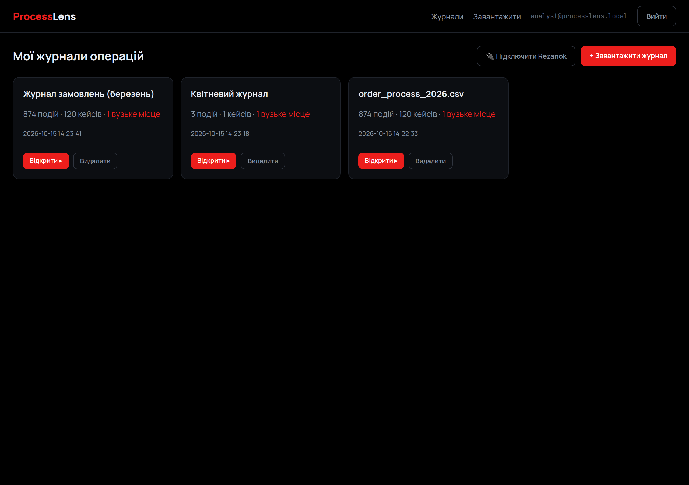
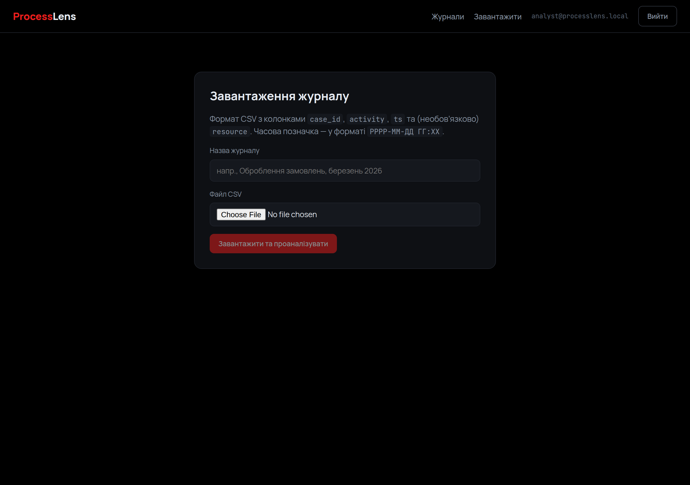
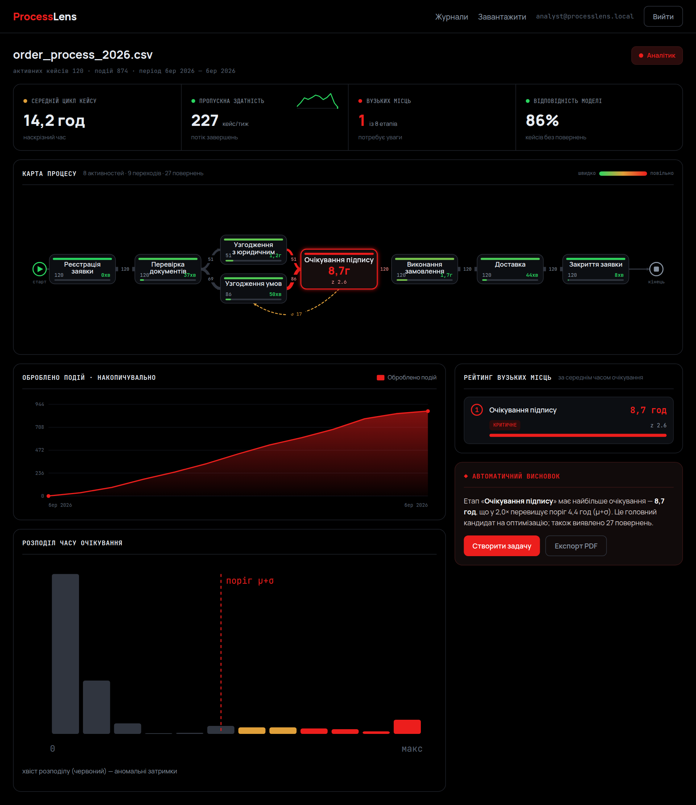
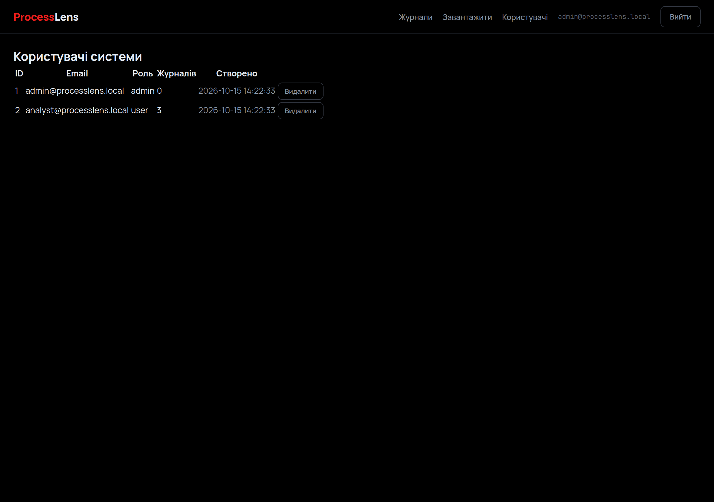

# ProcessLens · основний інтерфейс

> Лабораторна робота №5 — **Вебпрограмування**
> Виконав: **Коваль Денис**

| | |
|---|---|
| **Застосунок** | ProcessLens — пошук «вузьких місць» у бізнес-процесах |
| **Тема** | основний інтерфейс, CRUD, керування станом |
| **Стек** | React 18 · Vite 5 · React Router 6 · vis-network |
| **Порт** | `5173` (dev), проксі `/api` → `3001` |

---

## Що це

П'ята робота наповнює каркас клієнта повноцінним інтерфейсом: користувач переглядає свої журнали, завантажує нові, відкриває детальну аналітику з візуалізацією процесу й видаляє непотрібні записи. Адміністратор додатково керує обліковими записами. У центрі уваги — операції над даними (CRUD), керування станом сесії та взаємодія з API.

## Керування станом

Стан сесії централізовано в **AuthContext** (`React Context` + хук `useAuth`): тут зберігаються токен і профіль користувача, а також методи входу й виходу. Токен зберігається у `localStorage`, тож сесія переживає перезавантаження сторінки. Решта даних (журнали, деталі аналізу, користувачі) завантажується на рівні сторінок через обгортку `api()` і тримається в локальному стані компонентів (`useState` + `useEffect`), з індикаторами завантаження та обробкою помилок.

## Операції над даними (CRUD)

| Дія         | Де                     | Як реалізовано                                         |
| ----------- | ---------------------- | ----------------------------------------------------- |
| **Перегляд**| Журнали, Аналіз        | `GET /api/logs`, `GET /api/logs/:id` + похідні метрики |
| **Створення**| Завантаження          | форма з файлом → `POST /api/logs` (multipart)          |
| **Видалення**| Журнали, Користувачі   | `DELETE /api/logs/:id`, `DELETE /api/admin/users/:id`  |

Після успішних дій списки оновлюються, а користувач отримує зворотний зв'язок (повідомлення про помилку чи перехід на сторінку створеного запису).

## Візуалізація

Детальна сторінка журналу — ядро інтерфейсу. Процес показано **картою** (граф етапів на `vis-network`) із підсвіткою вузьких місць, поруч — ключові показники (середній час кейсу, пропускна здатність, кількість вузьких місць, відповідність моделі), накопичувальний графік оброблених подій, гістограма розподілу часу очікування з порогом `μ+σ` та рейтинг вузьких місць із автоматичним висновком.

## Сторінки інтерфейсу

- **Журнали** — список журналів користувача з лічильниками та діями «Відкрити» / «Видалити»;
- **Завантаження** — форма додавання нового CSV-журналу;
- **Аналіз** — детальна аналітика обраного журналу з візуалізацією;
- **Користувачі** — таблиця облікових записів із видаленням (лише для адміністратора).

## Демо

Список журналів користувача — перегляд і дії над записами:



Форма завантаження нового журналу (створення):



Детальна аналітика журналу — карта процесу, показники та графіки:



Адмінпанель — керування користувачами системи:



## Запуск

```bash
npm install
npm run dev     # http://localhost:5173 (бекенд на :3001)
```

Демо-акаунти: `analyst@processlens.local / analyst123`, `admin@processlens.local / admin123`.

## Підсумок

Каркас клієнта ProcessLens перетворено на завершений інтерфейс: реалізовано повний цикл роботи з журналами (перегляд, створення через завантаження файлу, видалення), адміністрування користувачів, централізоване керування станом сесії через Context та обробку даних на сторінках із індикаторами й повідомленнями про помилки. Детальну сторінку побудовано навколо візуалізації процесу — графа етапів із підсвіткою вузьких місць та набору аналітичних графіків. Інтерфейс повністю працює з API серверної частини з попередніх робіт, демонструючи цілісний клієнт-серверний застосунок.
